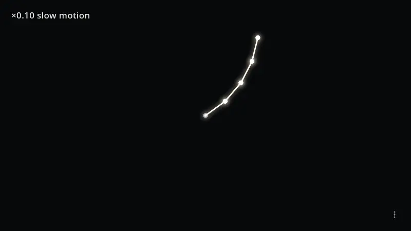
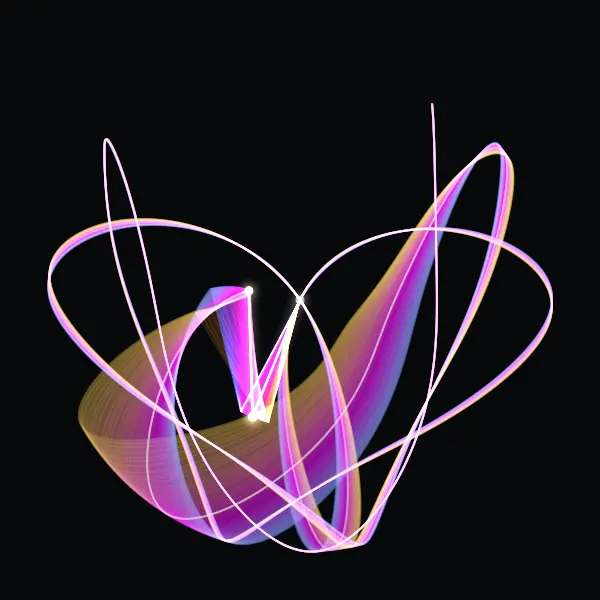
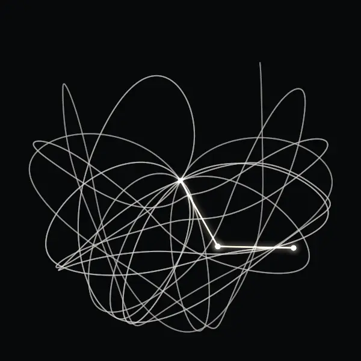
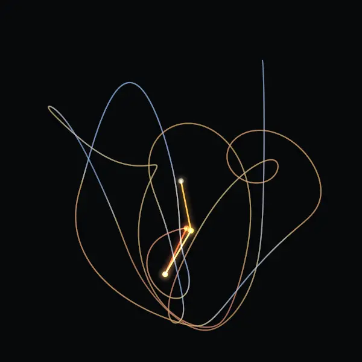

# Pendulum

[](https://github.com/rafa-el-souza/pendulum/actions/workflows/ci.yml?query=branch%3Amain)
[](https://pendulum.rafasouza.dev.br/)
[](LICENSE)
[](https://arxiv.org/abs/1910.12610v2)
[](web/e2e/)

<a href="https://pendulum.rafasouza.dev.br/"></a>

Interactive browser pieces built on one physics paper. Before any of it
reached a screen, the paper was checked equation by equation.

<table>
  <tr>
    <td width="33%" valign="top"><a href="https://pendulum.rafasouza.dev.br/?twins=4096"></a><br>4 096 twins, born a hair apart, part in colour.</td>
    <td width="33%" valign="top"><a href="https://pendulum.rafasouza.dev.br/?twins=0&amp;trail=10"></a><br>The tip's path, kept ten seconds.</td>
    <td width="33%" valign="top"><a href="https://pendulum.rafasouza.dev.br/?twins=0&amp;tension=1&amp;n=3&amp;trail=10"></a><br>Each rod in the colour of its tension.</td>
  </tr>
</table>

Each picture opens the site at the address it was taken from; the
animation opens the site as it starts.

The site: <https://pendulum.rafasouza.dev.br/>, published from `main`
after every check passes.

The paper is Boran Yeşilyurt's *Equations of Motion Formulation of a Pendulum
Containing N-point Masses*
([arXiv:1910.12610v2](https://arxiv.org/abs/1910.12610v2)). It covers a
planar pendulum of n point masses, gives one formula for any n, and shows the
hanging rope it becomes as n grows.

## What is here today

- **The paper, checked.** Every display equation was compared with a
  derivation of its own. Of 92, 73 are right as printed, 14 carry a misprint
  and 5 hold under a stated reading. The registry, the 400 tests that decide
  it and what was found are in [`physics/`](physics/README.md).
- **The decisions**, each with its reason and the measurements behind it,
  and the questions still open: [`docs/decisions.md`](docs/decisions.md).
- **The web app's skeleton** in [`web/`](web/): one page per piece over a
  shared core, opened in Chromium, Firefox and WebKit on every change.
- **The physics in the browser**, in [`web/src/physics/`](web/src/physics/):
  the chain by the rod-tension route in double precision, and its motion in
  time by RK4 in substeps taken from the rod tensions. It is tested against
  answers the oracle writes, within 1e-12, against the paper's general
  formula, and by the energy along chaotic motion. The normal modes of the
  chain of equal masses come from the zeros of Laguerre polynomials, and are
  tested against the modes the oracle finds by another route.
- **The first piece, begun,** called
  [Pendulum](https://pendulum.rafasouza.dev.br/) for now, which opens
  at the site's root while it is the only piece. A chain drawn as light, to
  grab anywhere and throw. Its number of masses runs from 1 to 512
  while it moves, its time from a tenth of real time to four times it, its
  gravity from none to Jupiter's, pointing any way round, and the hand that
  holds it from a rubber band to a firm grip.
  Let go, it leaves 512 twins born a hair apart, which fan out in colour to
  show chaos, as many as the device's cores carry side by side, and its tip
  and theirs leave trails of light that fade. The
  twins fade as chaos carries them off and are born again on the chain, so
  that they come out of it as a plume, or they can stay, a cloud over the
  whole disc once the fan has opened; either way they can be drawn as
  chains or as dust, each its tip alone, a point of light. How many twins there are, how
  far apart they are born, whether they fade and how they are drawn, how
  long the trails last and whether they leave a mark that stays, whether
  they are drawn as lines or by a strobe, the whole chain stamped at even
  times, whether every mass of the chain leaves one
  and which of ten palettes colours the twins are controls too, and so is
  the ground, one of eleven dark colours, each with a chain's colour to go
  with it. One switch puts out the twins and the
  trails and lights them again, time can run backwards until the fan
  closes, as far as chaos allows, and the G key passes the whole frame
  through the light of the first sketch, to compare.
  The chain starts raised to one side, or at rest in one of the paper's four
  lowest normal modes at an amplitude of the visitor's choice: small, it
  keeps the mode's shape and its twins stay together; large, the shape
  breaks up and the fan opens. Any moment of it can be saved in the address,
  with the whole screen around it in a short code, and opens again as it
  was, under a title that names it and the minute it was saved. A control paints each rod by how hard
  it pulls against the weight it holds, in one of four scales: in the
  first, warm where
  the chain is pulled hard, at the bottom of a swing or in a whip's crack,
  blue where it goes slack, and violet where a rod pushes, which a chain of
  links could not do. And the
  pivot can shake, a millimetre either way hundreds of times a second, on
  which the chain stands on its head, as Kapitza's pendulum does: up to
  twelve masses; from sixteen, the shake takes the chain apart.
  The controls wait behind one small button in a corner, which opens a thin
  row of icons: the pause, the light, and six groups, time and the start,
  the chain, the twins, the trails, the music and the screen, each opening
  its own row of icons above it. Each control has a key too, and the address carries every
  value and switch, so a view can be shared: through the device's own sheet
  for sharing, or as a QR code to open it on a phone. And it can listen to
  music, through the microphone, from a file, from the sound of a browser
  tab or of the whole screen in desktop Chrome and Edge, or from a beat it
  makes itself, with a card that shows what it hears; the sound stays on
  the device. The music lights the chain's halo on the kicks, gives its
  trails strength with the loudness, and has twins born again from it on
  every attack; it does not move the chain yet. The card offers candidates
  beside that, each changing one thing of it: a stronger halo, twins born
  again on the hits of drums or on the strongest kicks only, trails that
  last longer or brighten on the kicks, a fan that opens wider with the
  loudness, and the note the bass plays colouring the chain or the twins.

Every piece is meant to run fullscreen in the major browsers.

## How it is built

In Claude Code sessions, following [`CLAUDE.md`](CLAUDE.md). Each slice of
work is one pull request, merged once CI is green. CI runs the oracle's lint
and tests, the web app's checks with every page in three browser engines, and
a secret scan of every commit. On `main`, once all of them pass, it publishes
the tested build to GitHub Pages.

## Running the checks

Needs [uv](https://docs.astral.sh/uv/) and [Node](https://nodejs.org/) 26;
the pre-commit hook also needs
[gitleaks](https://github.com/gitleaks/gitleaks).

```sh
git config core.hooksPath .githooks   # once per clone: secret scan before each commit

cd physics/oracle
uv sync
uv run pytest                         # every equation of the paper, about half a minute
uv run ruff check
uv run ruff format --check

cd ../../web
npm ci
npm run typecheck
npm run lint
npm run format:check
npm test                              # unit tests
npm run e2e                           # every page in the three engines
npm run dev                           # the app, at http://127.0.0.1:5173/
```

`npm run e2e` needs Playwright's browsers; `npm run e2e:browsers` installs
them with their system packages on Ubuntu. CI runs the browser tests in
Playwright's own image of the same version, which has them.

`npm run media` takes the pictures at the top of this README again, from the
published site, into `docs/media/`; `npm run media -- fan` takes one.

## Layout

| Path | What it holds |
|---|---|
| `physics/` | the check of the paper: the registry, the oracle, the oracle's answers that the browser's physics is tested against, and how to rebuild a local copy of the paper |
| `web/` | the browser app: the registry of pieces, one page per piece, the shared core in `src/core/`, the physics in `src/physics/`, unit tests beside the code and browser tests in `e2e/`, and in `scripts/` the script that draws the site's icon, a frame of the first piece, with its physics, and the one that takes the README's pictures |
| `docs/media/` | the README's pictures, taken from the site by `web/scripts/readme-media.ts` |
| `docs/decisions.md` | the decisions, their reasons and evidence, and the open questions |
| `.github/` | CI and the pull request template |
| `.githooks/` | the pre-commit secret scan |
| `CLAUDE.md` | the rules the sessions that build Pendulum follow |

## Licence

MIT; see [LICENSE](LICENSE). The paper is not part of the repository:
[`physics/README.md`](physics/README.md) says why, and how to rebuild a local
copy.
